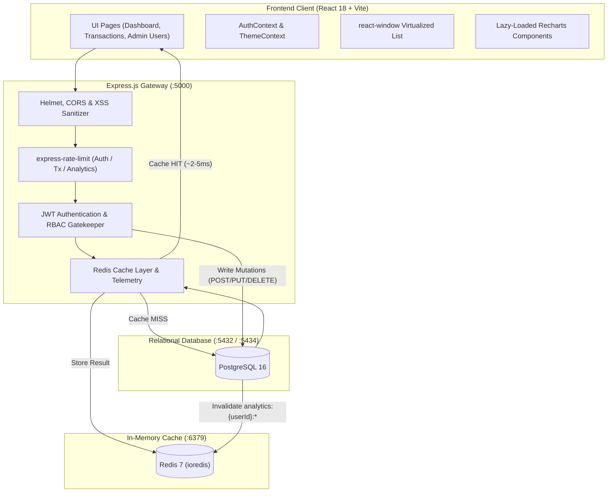

# 💰 Personal Finance Tracker

An enterprise-grade, full-stack Personal Finance Tracker engineered with high-performance caching, strict role-based access control (RBAC), real-time interactive analytics, virtualized scrolling, and OpenAPI 3.0 documentation.

---

## 📑 Table of Contents
- [Architecture & Tech Stack](#architecture--tech-stack)
- [System Architecture](#system-architecture)
- [Key Features](#key-features)
- [Demo Credentials](#demo-credentials)
- [RBAC Permission Matrix](#rbac-permission-matrix)
- [Caching & Invalidation Strategy](#caching--invalidation-strategy)
- [Rate Limiting Configuration](#rate-limiting-configuration)
- [Performance & Benchmark Results](#performance--benchmark-results)
- [Project Directory Structure](#project-directory-structure)
- [Local Development Setup](#local-development-setup)
- [Interactive API Documentation (Swagger)](#interactive-api-documentation-swagger)
- [Deployment Guide](#deployment-guide)

---

## 🛠 Architecture & Tech Stack

### Frontend
- **Core:** React 18 (Vite 6) with Fast Refresh & Strict Mode
- **Routing & Splitting:** React Router v6 with `React.lazy()` & `<Suspense>` route-based and component-based code-splitting
- **Charts:** Recharts (responsive Pie, Grouped Bar, and Multi-line Trend charts)
- **Virtual Scrolling:** `react-window` (`FixedSizeList`) for 1,000+ item performance
- **State & Theming:** Custom `AuthContext` and `ThemeContext` (Persisted Dark & Light themes)
- **Icons & Styling:** Lucide React icons, CSS variables design system

### Backend
- **Core Runtime:** Node.js + Express.js
- **Database:** PostgreSQL 16 (via native `pg` connection pool with 100% parameterized queries)
- **Cache & Telemetry:** Redis 7 (via `ioredis` with non-blocking key pattern invalidation & hit/miss metrics)
- **Auth & RBAC:** Stateless JWT tokens (`jsonwebtoken`) + `bcryptjs` salt hashing (cost 10)
- **Security:** Helmet, CORS, XSS sanitization (`xss`), express-validator, input validation schemas
- **API Documentation:** OpenAPI 3.0 / Swagger UI (`swagger-ui-express` + `swagger-jsdoc`)

---

## 🏛 System Architecture



---

## ✨ Key Features

- **Granular RBAC System:** Enforces access across `admin`, `user`, and `read-only` accounts at both the database query layer and client UI.
- **Dynamic Transaction Management:** Filter by date range, min/max amount, transaction type, and category; sort by date or amount; debounced live search (400ms).
- **Virtual Scrolling:** Switch to *"Show all (virtualized)"* mode using `react-window` to smoothly scroll through hundreds of records with constant memory usage.
- **Interactive Financial Dashboard:**
  - **Category Pie Chart:** Click-to-highlight active slice with percentage callout and alongside legend.
  - **Grouped Bar Chart:** Monthly income vs. expense side-by-side comparison.
  - **Trend Line Chart:** 12-month historical cashflow with smooth splines.
  - **Yearly View:** Historical year-over-year financial growth overview.
- **Sub-Millisecond Redis Caching:** Responses cached with `X-Cache: HIT` / `MISS` headers; automatic invalidation on transaction modifications.
- **Swagger / OpenAPI Documentation:** Complete interactive API reference served at `/api/docs`.

---

## 👤 Demo Credentials

The database is pre-seeded with realistic financial records over the past 12 months for the following demo users (Password for all: `Demo@1234`):

| Role | Email | Password | Primary Capabilities |
| :--- | :--- | :--- | :--- |
| **Admin** | `admin@demo.com` | `Demo@1234` | Full access, user management, metrics inspection, demote/promote roles |
| **Standard User** | `user@demo.com` | `Demo@1234` | Create, edit, and delete own transactions; view analytics |
| **Read-Only** | `readonly@demo.com` | `Demo@1234` | View own transactions & analytics; write actions disabled and blocked |

---

## 🛡 RBAC Permission Matrix

| Endpoint | Method | Admin | User | Read-Only | Unauthenticated |
| :--- | :---: | :---: | :---: | :---: | :---: |
| `/api/auth/register`, `/login` | `POST` | ✅ | ✅ | ✅ | ✅ |
| `/api/auth/me` | `GET` | ✅ | ✅ | ✅ | ❌ (401) |
| `/api/categories` | `GET` | ✅ | ✅ | ✅ | ❌ (401) |
| `/api/transactions` | `GET` | ✅ (all / any user) | ✅ (own records) | ✅ (own records) | ❌ (401) |
| `/api/transactions` | `POST` | ✅ | ✅ | ❌ (403) | ❌ (401) |
| `/api/transactions/:id` | `PUT` | ✅ | ✅ (own only) | ❌ (403) | ❌ (401) |
| `/api/transactions/:id` | `DELETE` | ✅ | ✅ (own only) | ❌ (403) | ❌ (401) |
| `/api/analytics/*` | `GET` | ✅ | ✅ | ✅ | ❌ (401) |
| `/api/users`, `/users/:id` | `GET` | ✅ | ❌ (403) | ❌ (403) | ❌ (401) |
| `/api/users/:id/role` | `PATCH` | ✅ (cannot demote self) | ❌ (403) | ❌ (403) | ❌ (401) |
| `/api/users/:id` | `DELETE` | ✅ (cannot delete self) | ❌ (403) | ❌ (403) | ❌ (401) |
| `/api/metrics/cache` | `GET` | ✅ | ❌ (403) | ❌ (403) | ❌ (401) |

---

## ⚡ Caching & Invalidation Strategy

| Resource | Cache Key Pattern | TTL | Invalidation Trigger |
| :--- | :--- | :--- | :--- |
| **Categories List** | `categories:all` / `categories:{type}` | 3,600s (1 hr) | Admin category creation / edit |
| **User Analytics Summary** | `analytics:{userId}:summary:{hash}` | 900s (15 min) | Any transaction create, update, or delete |
| **Category Breakdown** | `analytics:{userId}:category-breakdown:{hash}` | 900s (15 min) | Any transaction create, update, or delete |
| **Monthly Trends** | `analytics:{userId}:trends:{hash}` | 900s (15 min) | Any transaction create, update, or delete |
| **Fail-Open Mechanism** | Global | N/A | If Redis goes offline, requests fallback gracefully to PostgreSQL |

---

## ⏱ Rate Limiting Configuration

Applied via `express-rate-limit` to prevent brute force and denial of service:

| Route Scope | Limit | Window | Purpose |
| :--- | :--- | :--- | :--- |
| `/api/auth/login`, `/register` | 5 requests | 15 minutes | Brute-force & credential stuffing defense |
| `/api/transactions` | 100 requests | 1 hour | API scraping & spam transaction mitigation |
| `/api/analytics` | 50 requests | 1 hour | Expensive SQL aggregation throttling |

*(Rate limits can be toggled via `RATE_LIMIT_DISABLED=true` in `.env` for testing).*

---

## 📊 Performance & Benchmark Results

Real measured latency benchmark from `docs/PERFORMANCE.md` using `npm run benchmark`:

| Endpoint | Cache MISS (PostgreSQL) | Avg Cache HIT (Redis) | Latency Reduction |
| :--- | :--- | :--- | :--- |
| `/api/analytics/summary` | **17.98 ms** | **5.08 ms** | **71.7% faster** |
| `/api/analytics/category-breakdown` | **13.82 ms** | **4.86 ms** | **64.8% faster** |
| `/api/analytics/trends` | **11.92 ms** | **2.63 ms** | **77.9% faster** |
| `/api/categories` | **7.16 ms** | **3.85 ms** | **46.2% faster** |

- **Redis Cache Hit Rate:** **86.14%** (measured via `/api/metrics/cache`).
- **Code-Split Frontend Bundles:** Recharts math and charting libraries (`~374 KB`) are lazy-loaded on demand.

---

## 📁 Project Directory Structure

```text
techbridge-finance_tracker/
├── backend/
│   ├── scripts/
│   │   ├── benchmark.js       # Cache latency and metrics benchmark runner
│   │   ├── migrate.js         # SQL schema migration runner
│   │   ├── seed.js            # Database seeding script (demo users & 200+ txs)
│   │   └── smoke-test.js      # Automated RBAC and caching verification
│   ├── src/
│   │   ├── config/            # Environment variable configuration
│   │   ├── controllers/       # Auth, transactions, analytics, and users controllers
│   │   ├── db/                # PostgreSQL pool, Redis client & schema.sql
│   │   ├── docs/              # OpenAPI 3.0 / Swagger specification
│   │   ├── middleware/        # JWT authenticate, RBAC authorize, sanitize, rate-limiters
│   │   ├── routes/            # Express route definitions
│   │   ├── services/          # SQL queries and Redis caching business logic
│   │   ├── app.js             # Express application setup
│   │   └── server.js          # Server entry point
│   ├── Dockerfile
│   └── package.json
├── frontend/
│   ├── src/
│   │   ├── api/               # Axios client instance with Bearer interceptor
│   │   ├── components/
│   │   │   ├── common/        # Toast, SkeletonRow, Navbar
│   │   │   ├── dashboard/     # ExpensePieChart, MonthlyBarChart, TrendLineChart, YearlyBarChart
│   │   │   └── transactions/  # Filters, SummaryStrip, Modals, VirtualTransactionList
│   │   ├── context/           # AuthContext (user, tokens, RBAC) & ThemeContext
│   │   ├── hooks/             # useTransactions, useCategories, useDebounce
│   │   ├── pages/             # Login, Register, Dashboard, Transactions, Users, Forbidden
│   │   ├── App.jsx            # Routing with lazy loading and route guards
│   │   └── index.css          # Theme variables & CSS design system
│   ├── Dockerfile
│   ├── nginx.conf
│   └── package.json
├── docs/
│   └── PERFORMANCE.md         # Detailed latency benchmark report & bundle stats
├── docker-compose.yml         # Multi-container setup (Postgres 16 + Redis 7)
├── render.yaml                # 1-click cloud deployment blueprint
├── package.json               # Root scripts (concurrently dev runner)
└── README.md                  # Master documentation
```

---

## 🚀 Local Development Setup

### Prerequisites
- [Node.js](https://nodejs.org/) (v18+ recommended)
- [Docker & Docker Compose](https://www.docker.com/)

### Step 1: Clone Repository
```bash
git clone https://github.com/your-username/finance-tracker.git
cd finance-tracker
```

### Step 2: Start PostgreSQL & Redis Containers
```bash
docker compose up -d
```
*(Postgres starts on port `5434` / container port `5432`; Redis starts on port `6379`).*

### Step 3: Configure Environment Variables
Copy `.env.example` files:
```bash
# Backend
cp backend/.env.example backend/.env

# Frontend
cp frontend/.env.example frontend/.env
```

### Step 4: Run Migrations & Seed Demo Data
```bash
npm run db:migrate --prefix backend
npm run db:seed --prefix backend
```

### Step 5: Start Both Applications Concurrently
```bash
npm install
npm run dev
```
- **Frontend:** [http://localhost:5173](http://localhost:5173)
- **Backend API:** [http://localhost:5000](http://localhost:5000)
- **Interactive Swagger Docs:** [http://localhost:5000/api/docs](http://localhost:5000/api/docs)

---

## 📖 Interactive API Documentation (Swagger)

Full OpenAPI 3.0 specification is available at:
👉 **[http://localhost:5000/api/docs](http://localhost:5000/api/docs)**

Raw OpenAPI JSON definition:
👉 **[http://localhost:5000/api/docs.json](http://localhost:5000/api/docs.json)**

Features interactive Bearer Token authorization, schema inspection, query parameter documentation, and live endpoint testing.

---

## ☁️ Deployment Guide

### Option 1: Docker Containers
Both backend and frontend contain multi-stage production Dockerfiles:
```bash
# Build and run backend container
docker build -t finance-backend ./backend
docker run -p 5000:5000 --env-file backend/.env finance-backend

# Build and run frontend container with Nginx
docker build -t finance-frontend ./frontend
docker run -p 80:80 finance-frontend
```

### Option 2: 1-Click Cloud Deployment (Render Blueprint)
This repository includes a [`render.yaml`](file:///c:/Users/nikhi/OneDrive/Desktop/techbridge-finance_tracker/render.yaml) specification:
1. Connect this repository to your [Render Dashboard](https://render.com/).
2. Select **New Blueprint Instance**.
3. Render will provision the Managed PostgreSQL, Managed Redis, Backend Node Web Service, and Frontend Static Site automatically with wired environment variables.

---

## 🧪 Testing & Verification Scripts

```bash
# Run comprehensive backend smoke test (12 RBAC & Cache assertions)
npm run smoke

# Run high-resolution latency benchmark
npm run benchmark

# Verify production frontend build & chunk splitting
npm run build
```

---

## 📄 License
This project is licensed under the MIT License.
